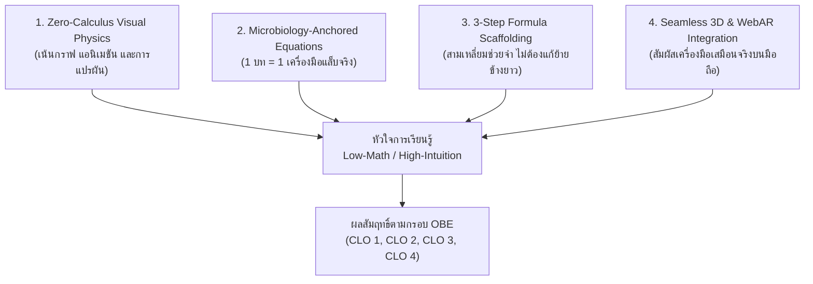
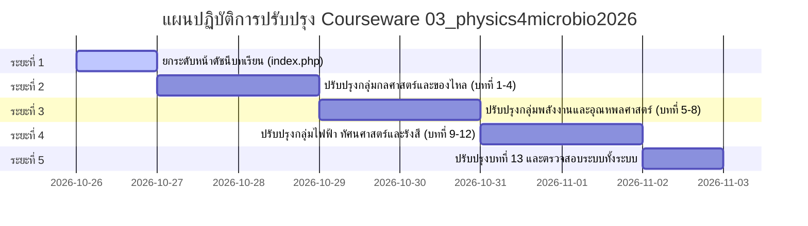

# แผนแม่บทการปรับปรุงหัวข้อ เนื้อหา และภาพประกอบทั้งระบบ
## รายวิชา 4011111 ฟิสิกส์สำหรับจุลชีววิทยา (Physics for Microbiology 2026/2027)
**หน่วยกิต:** 3(2-3-4) | **หลักสูตร:** วิทยาศาสตรบัณฑิต สาขาวิชาจุลชีววิทยา (ปรับปรุง พ.ศ. 2569/2570)  
**คณะวิทยาศาสตร์และเทคโนโลยี มหาวิทยาลัยราชภัฏรำไพพรรณี**  
**อาจารย์ผู้รับผิดชอบรายวิชา:** ผู้ช่วยศาสตราจารย์ ดร.ชีวะ ทัศนา (ศูนย์ LEQs-GLOBE อาคาร 35)  
**วันที่ประกาศใช้แผน:** 26 ตุลาคม พ.ศ. 2569 (เวอร์ชัน 2026.10-FINAL)

---

## 1. บทนำและหลักการและเหตุผล (Executive Summary & Rationale)

จากการพัฒนาและยกระดับห้องปฏิบัติการเสมือนจริง 3 มิติ (3D WebGL Virtual Lab Simulators) ครบทั้ง 12 ปฏิบัติการ พร้อมทั้งการจัดทำระบบฐานข้อมูลกลาง SQLite3 และระบบพอร์ทัลอาจารย์ผู้สอน (Instructor Console) เสร็จสมบูรณ์แล้วนั้น จำเป็นต้องมีการ**ปรับปรุงและยกระดับระบบเนื้อหาบทเรียนทฤษฎี (E-Courseware & Chapters)** ในไดเรกทอรี `03_physics4microbio2026/` ทั้งระบบ ให้สอดรับกับเอกสารคำสอนล่าสุด 3 เล่มหลักของหลักสูตร ได้แก่:

1. **แผนการจัดการเรียนรู้มุ่งเน้นผลลัพธ์ (OBE Course Syllabus — มคอ.3)** พ.ศ. 2569–2570
2. **เอกสารคำสอนและคู่มือสรุปสูตรฟิสิกส์ฉบับเข้าใจง่าย (Low-Math / High-Intuition Guide)**
3. **เอกสารคำสอนและสื่อจำลองเสมือนจริง 3D WebAR ArUco Marker (ID 0–11)** บนสมาร์ทโฟน

แผนแม่บทฉบับนี้กำหนดกรอบการดำเนินงาน โครงสร้างเนื้อหา รูปแบบการจัดวางภาพประกอบ และมาตรฐานคอมโพเนนต์ทางวิชาการ เพื่อให้การเรียนการสอนฟิสิกส์สำหรับนักศึกษาจุลชีววิทยาบรรลุผลสัมฤทธิ์สูงสุดตามกรอบ OBE และ AUN-QA

---

## 2. การวิเคราะห์ช่องว่างและการยกระดับ (Gap Analysis)

| มิติการประเมิน | สถานะระบบเดิมใน `03_physics4microbio2026/` | มาตรฐานใหม่ที่ยกระดับตามแผนแม่บท |
|:---|:---|:---|
| **1. ปรัชญาการสอน (Pedagogy)** | มีสมการคณิตศาสตร์ฟิสิกส์ทั่วไป มีการพิสูจน์แคลคูลัสและพีชคณิตยาว ซับซ้อน ไม่เหมาะกับพื้นฐานผู้เรียนชีวภาพ | ปรับเป็น **Low-Math, High-Intuition (Zero-Calculus)**: ใช้การเทียบสัดส่วนตรง/ผกผัน, กรอบคิด 3 ขั้นตอน, และสามเหลี่ยมช่วยจำ (Formula Triangles) |
| **2. ความเชื่อมโยงจุลชีววิทยา (Bio-Anchoring)** | บางบทยกตัวอย่างฟิสิกส์กายภาพทั่วไป (ลูกบอล, รถยนต์) ที่ห่างไกลจากวิชาชีพจุลชีววิทยา | ยึดหลัก **"1 บทเรียน = 1 เครื่องมือห้องแล็บจุลชีววิทยาจริง = 1 สูตรใช้งานจริง"** (ปิเปต, Centrifuge, Autoclave, กล้อง 100x Oil, สเปกโตรโฟโตมิเตอร์, ตู้ฉายรังสี) |
| **3. สื่อ 3D & WebAR** | ยังไม่ได้ผูกโยงเข้ากับ Three.js 3D Simulator 12 ตัว และกล้อง WebAR ArUco บนสมาร์ทโฟน | ฝัง **Interactive 3D / WebAR Action Card** ในทุกบทเรียน กดเปิดซิมูเลชัน 3D ได้ทันที และมีปุ่มเปิดกล้องส่องมาร์กเกอร์ ArUco ID 0–11 |
| **4. ภาพประกอบ (Visuals)** | ภาพประกอบหลายบทกระจุกตัวซ้อนกันเป็นชุด (Clustered) ขาดคำอธิบายบริบทและไดอะแกรมเวกเตอร์ | จัดเลย์เอาต์สไตล์ **Modern Academic Textbook (Springer/MIT Press)** แทรกภาพการ์ตูน 3D Pixar, แผนภาพ Infographic SVG, และคำอธิบายใต้ภาพ (Captions) เชิงลึก |
| **5. หน้าดัชนีบทเรียน (`index.php`)** | ใช้ดีไซน์รุ่นแรก สีสันยังไม่เป็นอันหนึ่งอันเดียวกัน และลิงก์บทเรียนบางส่วนยังไม่สมบูรณ์ | ยกระดับเป็น **Courseware Learning Hub Glassmorphism** แสดงสารบัญ 12 บทเรียน + 1 บทบูรณาการ พร้อมแถบสถิติและเครื่องมือนักศึกษา |

---

## 3. ปรัชญาการออกแบบเนื้อหา (4-Pillar Pedagogical Strategy)

1. **Zero-Calculus, Visual-First Physics:**
   - ตัดการใช้แคลคูลัสและการพิสูจน์สมการที่ซับซ้อน
   - แสดงความสัมพันธ์แบบแปรผันตรง ($\propto$) หรือแปรผกผัน ($1/x, 1/r^2$) ผ่านกราฟและตัวเลื่อนใน 3D Simulation
2. **Microbiology-Anchored Equations:**
   - ทุกสูตรฟิสิกส์ต้องตอบคำถามได้ว่า *"สูตรนี้ใช้ทำอะไรในห้องแล็บจุลชีววิทยา"*
3. **3-Step Formula Scaffolding (สามเหลี่ยมช่วยจำ):**
   - นำเสนอสูตรในรูปแบบสามเหลี่ยม เช่น กฎของโอห์ม ($V/I\cdot R$), ความหนาแน่น ($\rho/m\cdot V$), กฎของสเนลล์
   - มีโจทย์ตัวอย่างฝึกคำนวณ 3 ขั้นตอน: (1) ระบุสิ่งที่โจทย์บอก (2) เลือกสูตรสามเหลี่ยม (3) แทนค่าและตอบพร้อมหน่วย
4. **Interactive 3D & WebAR Action:**
   - ผู้เรียนสามารถคลิกเปิดโปรแกรมจำลอง 3 มิติเพื่อทดลองปรับพารามิเตอร์เสมือนจริงได้ทันทีขณะอ่านบทเรียน

---

## 4. แผนที่หลักสูตรและการเชื่อมโยงรายบท (12 Chapters + 1 Capstone Project)

| บทที่ | ชื่อบทเรียนทฤษฎี | เครื่องมือชีวภาพแกนหลัก (Anchor) | หัวใจสูตร Low-Math (3-Step Formula) | สื่อ 3D Simulator | สื่อ WebAR ArUco | ปฏิบัติการที่สอดคล้อง |
|:---:|:---|:---|:---|:---:|:---:|:---:|
| **1** | **ระบบหน่วยและการวัดระดับจุลภาค** (Units & Microscale Measurements) | ไมโครปิเปต P1000 และเครื่องชั่งดิจิทัล 4 ตำแหน่ง | บันไดคำอุปสรรค $\times 1,000$ ($\text{mL} \leftrightarrow \mu\text{L} \leftrightarrow \text{nL}$) ความหนาแน่น $\rho = m/V$ ($1\ \mu\text{L} = 1\text{ mg}$) | `sim_micropipette_3d.html` | Marker ID 0 | `lab01_measurement.php` |
| **2** | **เวกเตอร์และแรงในระบบชีวภาพ** (Vectors & Microbial Biomechanics) | การว่ายน้ำหาอาหาร (Chemotaxis) และ Brownian Motion | เวกเตอร์ลูกศรหัวต่อหาง Chemotaxis (มีทิศ $\vec{v}$) vs Brownian ($\sum \vec{r} \approx 0$) | `sim02_force_vectors_3d.html` | Marker ID 1 | `lab02_vectors.php` |
| **3** | **จลนศาสตร์และความหนืดของของไหล** (Kinematics & Fluid Viscosity) | หลอดวัดความหนืด (Viscometer) และอาหารเลี้ยงเชื้อเหลว | กฎของสโตกส์เทียบสัดส่วน $v_{\text{sed}} \propto r^2 / \eta$ เซลล์โต 2 เท่า ตกเร็ว 4 เท่า | `sim03_viscometer_3d.html` | Marker ID 2 | `lab03_motion.php` |
| **4** | **กฎของนิวตันและเครื่องปั่นเหวี่ยง** (Newton's Laws & Centrifuge Dynamics) | เครื่องปั่นเหวี่ยงความเร็วสูง (High-Speed Centrifuge) | $\text{RCF} = 1.118\times 10^{-5} \cdot r \cdot (\text{RPM})^2$ เพิ่มรอบ 2 เท่า แรงเหวี่ยงพุ่ง 4 เท่า! $\sum \vec{F} = 0$ | `sim04_centrifuge_3d.html` | Marker ID 3 | `lab04_newton.php` |
| **5** | **โมเมนตัมและการชนในระดับเซลล์** (Cellular Momentum & Collisions) | เครื่องผสมสาร Vortex Mixer และ Shaker | การอนุรักษ์โมเมนตัม $p = mv$ แรงดลและการแตกตัวของผนังเซลล์ (Cell Lysis) | `sim05_momentum_3d.html` | Marker ID 4 | `lab05_momentum.php` |
| **6** | **สมดุลกล ความดันของไหล และออสโมซิส** (Equilibrium, Pressure & Osmosis) | หลอดออสโมมิเตอร์ และสภาวะเซลล์เต่ง/เหี่ยว | ความดันออสโมติกแวนต์ฮอฟฟ์ $\Pi = cRT$ แรงตึงผนังเซลล์เพปทิโดไกลแคน (Turgor Pressure) | `sim06_osmosis_3d.html` | Marker ID 5 | `lab06_equilibrium.php` |
| **7** | **งาน พลังงาน และมอเตอร์โมเลกุลชีวภาพ** (Work, Energy & ATP Synthase) | เอนไซม์สร้างพลังงาน $F_0 F_1$ ATP Synthase | พลังขับเคลื่อนโปรตอน (PMF) $\Delta p = \Delta \psi - 60\Delta\text{pH}$ ประสิทธิภาพการเปลี่ยนพลังงานสู่โมเลกุล ATP | `sim07_molecular_motors_3d.html` | Marker ID 6 | `lab07_energy.php` |
| **8** | **การหมุนและกลศาสตร์นาโนของแส้เซลล์** (Rotational Dynamics & Flagella) | มอเตอร์ฐานแส้แบคทีเรีย (Bacterial Flagella) | ทอร์กการหมุน $\tau = I\alpha$ กำลังกลศาสตร์นาโน $P = \tau\omega$ (รอบหมุน 300 Hz) | `sim08_nanomechanics_3d.html` | Marker ID 7 | `lab08_machines.php` |
| **9** | **อุณหพลศาสตร์และหม้อนึ่ง Autoclave / PCR** (Thermodynamics & Autoclave / PCR) | หม้อนึ่งความดันไอ $121^\circ\text{C}$ และเครื่อง PCR Cycler | ความร้อนแฝง $Q = mL_v$ ($2,260\text{ J/g}$ ไอน้ำฆ่าสปอร์) ความดัน $15\text{ psi}$ จุดเดือดพุ่ง $121^\circ\text{C}$ & วัฏจักร PCR | `sim09_pcr_thermal_3d.html` | Marker ID 8 | `lab09_heat.php` |
| **10** | **ไฟฟ้าและเจลอิเล็กโทรโฟเรซิส** (Electricity & Gel Electrophoresis) | ถาดเจลอกาโรสและหลอด UV Transilluminator | สามเหลี่ยมกฎของโอห์ม ($V = IR$) ประจุลบของ DNA วิ่งหาขั้วบวก แบนด์เล็กวิ่งเร็ว | `sim10_electrophoresis_3d.html` | Marker ID 9 | `lab10_electricity.php` |
| **11** | **ทัศนศาสตร์ กล้องจุลทรรศน์ และสเปกโทรโฟโตเมตรี** (Optics, Microscopy & Spectroscopy) | กล้องจุลทรรศน์ $100\times$ Oil และเครื่องวัด OD600 | ขีดจำกัดแอบบี $d = \lambda / (2\text{NA})$ ($n = 1.518$) กฎเบียร์-แลมเบิร์ต $A = \varepsilon b c$ วัดความขุ่น $\text{OD}_{600}$ | `sim11_optics_3d.html` | Marker ID 10 | `lab11_optics.php` |
| **12** | **ฟิสิกส์นิวเคลียร์และการทำลายเชื้อจุลินทรีย์** (Nuclear Physics & Radiosterilization) | ตู้ฉายรังสีโคบอลต์-60 ($^{60}\text{Co}$) และหัววัด GM Tube | ครึ่งชีวิต $T_{1/2}$ และกฎกำลังสองผกผัน $I \propto 1/r^2$ ค่ารังสีลดเชื้อ 90% ($D_{10}$-value) และความหนาครึ่งค่า $HVL$ | `sim12_radioactivity_3d.html` | Marker ID 11 | `lab12_radioactivity.php` |
| **13** | **โครงงานบูรณาการชีวฟิสิกส์และการเกษตรอัจฉริยะ** (Capstone Mini-Project: Smart Bio-AI) | เครื่องมือวัดและเซนเซอร์ AIoT ในงานจุลชีววิทยา | การผสานหลักการฟิสิกส์ 8 หมวด สู่นวัตกรรมชีวภาพ การนำเสนอโครงงานย่อย (Mini-Project Presentation) | `virtual_lab/index.html` | Marker Hub | `lab13_miniproject` |

---

## 5. มาตรฐานคอมโพเนนต์และการจัดวางเลย์เอาต์ (Design Components Standard)

ทุกไฟล์บทเรียน (`ch01_th.php` ถึง `ch13_th.php`) จะต้องมีกล่องเนื้อหาอัจฉริยะ 6 แบบมาตรฐาน:

### 5.1 📌 Microbiology Instrument Anchor Box
* **วัตถุประสงค์:** ชูเครื่องมือวิทยาศาสตร์ในงานจุลชีววิทยาที่เป็นตัวเอกของบทเรียน
* **สไตล์:** การ์ดสีเขียวเอเมอรัลด์/ไซยาน พร้อมไอคอน FontAwesome และระบุยี่ห้อ/โมเดล/สเปกที่พบในห้องแล็บจริง

### 5.2 📐 Low-Math Formula Triangle Box
* **วัตถุประสงค์:** แสดงสูตรฟิสิกส์แบบ 3 ขั้นตอน พร้อมไดอะแกรมสามเหลี่ยมช่วยจำ ปราศจากการพิสูจน์แคลคูลัส
* **สไตล์:** การ์ดสีกรมท่าเข้มพร้อมกรอบสีส้มอำพัน เรนเดอร์สมการด้วย MathJax 3 คมชัด

### 5.3 🧪 Interactive 3D Simulator & WebAR Action Card
* **วัตถุประสงค์:** เชื่อมโยงบทเรียนเข้ากับโปรแกรมจำลอง 3 มิติ และกล้องส่อง WebAR ประจำบท
* **ฟังก์ชัน:**
  * ปุ่มที่ 1: `เปิด 3D Virtual Lab Simulator` (เปิดหน้าต่างใหม่เต็มจอ)
  * ปุ่มที่ 2: `เปิดกล้องส่อง 3D WebAR ArUco (ID xx)` บนสมาร์ทโฟน

### 5.4 ⚠️ Biosafety & Clinical Laboratory Warning Box
* **วัตถุประสงค์:** ปลูกฝังมาตรฐานความปลอดภัยในห้องแล็บ (Biosafety Level 1/2) และการป้องกันอุบัติเหตุ
* **สไตล์:** การ์ดแจ้งเตือนสีแดง/ส้ม พร้อมไอคอน Biohazard และคำอธิบายเชิงกลไกฟิสิกส์

### 5.5 💡 Clinical Case Study & Research Highlight Box
* **วัตถุประสงค์:** นำเสนอการประยุกต์ใช้ในโรงพยาบาล อุตสาหกรรมยา อาหาร และการเกษตรดิจิทัล
* **สไตล์:** การ์ดสีม่วงนีออน พร้อมบทความสั้นและคำถามกระตุ้นการคิดวิเคราะห์

### 5.6 🎯 OBE Formative Quiz (3 ข้อท้ายบท)
* **วัตถุประสงค์:** แบบทดสอบประเมินตนเองตามเกณฑ์ CLO 1–4 พร้อมปุ่มกดแสดงเฉลยและคำอธิบายฟิสิกส์

---

## 6. แผนการดำเนินงาน 5 ระยะ (5-Phase Implementation Roadmap)

### รายละเอียดแต่ละระยะ:

* **ระยะที่ 1 (Phase 1): ยกระดับหน้าดัชนีบทเรียนหลัก (`03_physics4microbio2026/index.php`)**
  * ออกแบบหน้ารวม 12 บทเรียน + 1 บทบูรณาการใหม่ด้วยเลย์เอาต์ Glassmorphism สอดคล้องกับพอร์ทัลหลัก
  * ฝังลิงก์สู่ 3D Simulators, WebAR Scanner, และ E-Reports ครบวงจร
* **ระยะที่ 2 (Phase 2): ปรับปรุงเนื้อหาและภาพประกอบกลุ่มกลศาสตร์ (บทที่ 1 – 4)**
  * ปรับปรุง `ch01_th.php` (หน่วยและการวัด, ปิเปต P1000)
  * ปรับปรุง `ch02_th.php` (เวกเตอร์, Chemotaxis vs Brownian)
  * ปรับปรุง `ch03_th.php` (จลนศาสตร์, สโตกส์, ความหนืด)
  * ปรับปรุง `ch04_th.php` (กฎนิวตัน, Centrifuge, RCF)
* **ระยะที่ 3 (Phase 3): ปรับปรุงเนื้อหาและภาพประกอบกลุ่มพลังงานและอุณหพลศาสตร์ (บทที่ 5 – 8)**
  * ปรับปรุง `ch05_th.php` (โมเมนตัม, การชน, การสลายเซลล์)
  * ปรับปรุง `ch06_th.php` (สมดุลไฮโดรสแตติก, ออสโมซิสแวนต์ฮอฟฟ์)
  * ปรับปรุง `ch07_th.php` (งาน, พลังงาน, ATP Synthase)
  * ปรับปรุง `ch08_th.php` (การหมุน, ทอร์ก, แส้เซลล์แบคทีเรีย)
* **ระยะที่ 4 (Phase 4): ปรับปรุงเนื้อหาและภาพประกอบกลุ่มไฟฟ้า ทัศนศาสตร์ และรังสี (บทที่ 9 – 12)**
  * ปรับปรุง `ch09_th.php` (อุณหพลศาสตร์, ไอน้ำ Autoclave, PCR Cycler)
  * ปรับปรุง `ch10_th.php` (ไฟฟ้า, เจลอิเล็กโทรโฟเรซิส, แบคทีเรียแม่เหล็ก)
  * ปรับปรุง `ch11_th.php` (ทัศนศาสตร์, กล้อง 100x Oil, สเปกโตรโฟโตเมตรี)
  * ปรับปรุง `ch12_th.php` (ฟิสิกส์นิวเคลียร์, รังสีฆ่าเชื้อ D10, GM Counter)
* **ระยะที่ 5 (Phase 5): ปรับปรุงบทที่ 13 (Capstone Mini-Project) และตรวจสอบระบบรวม**
  * ปรับปรุง `ch13_th.php` (โครงงานชีวฟิสิกส์อัจฉริยะและการเกษตรแม่นยำ)
  * ตรวจสอบความถูกต้องของลิงก์และสมการ MathJax 3
  * ทดสอบการแสดงผลบนสมาร์ทโฟน แท็บเล็ต และคอมพิวเตอร์ (Responsive Verification)
  * บันทึก Git Version Control

---

## 7. เกณฑ์การประกันคุณภาพและการตรวจรับงาน (Quality Assurance Checklist)

- [ ] ทุกบทเรียนยึดโยงกับเครื่องมือจุลชีววิทยาจริงอย่างน้อย 1 ชนิด (Microbiology Anchor)
- [ ] มีกล่องสามเหลี่ยมสูตร Low-Math ปราศจากแคลคูลัสและการพิสูจน์ซับซ้อน
- [ ] มีลิงก์และปุ่มกดเปิดโปรแกรมจำลอง 3D WebGL Simulator ทำงานได้จริง (HTTP 200)
- [ ] มีปุ่มและคำแนะนำเปิดกล้องส่อง 3D WebAR ArUco Marker ประจำบท
- [ ] ภาพประกอบทุกภาพมีคำอธิบายใต้ภาพ (Captions) ชัดเจน ไม่วางภาพกระจุกตัว
- [ ] สมการทางคณิตศาสตร์แสดงผลด้วย MathJax 3 สวยงาม ไร้กล่องสี่เหลี่ยมเต้าหู้
- [ ] มีข้อควรระวังด้านความปลอดภัยในห้องแล็บ (Biosafety & Lab Safety)
- [ ] มีแบบทดสอบท้ายบทประเมินผลตามเกณฑ์ CLO 1–4

---

*จัดทำโดย: ผู้ช่วยศาสตราจารย์ ดร.ชีวะ ทัศนา และทีมพัฒนาระบบการเรียนรู้ดิจิทัล LEQs-GLOBE*  
*คณะวิทยาศาสตร์และเทคโนโลยี มหาวิทยาลัยราชภัฏรำไพพรรณี*
